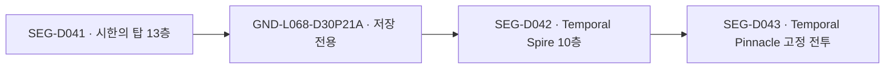

# 길드 복귀 없는 연속 원정과 캥카 연결부

<!-- gameplay-crossrefs -->
각 진행표의 **구간 숫자를 누르면 적·아이템·보스·진행 조건 상세 문서**를 연다. [자료/비율 해석](../2026-10-21-full-map-audit/GAMEPLAY_DATA.md) · [특수 진행/필요 아이템](../2026-10-21-full-map-audit/PROGRESSION.md).

기준: 보존한 『하늘의 탐험대』 ROM과 스토리/던전 웹 자료. 조사일2026-10-21. **분류 자료이며 현재 게임의 자동 귀환·맵 선택 동작은 바꾸지 않았다.**

던전의 한 구간을 끝낸 것과 원정을 끝낸 것을 구분해야 한다. 본편 시한의 탑41을 끝내면 길드로 돌려보내지 않고 중간 쉼터를 거쳐42로, 그 뒤43의 정상 전투로 이어지는 구조다. 같은 원정에서 서로 다른 MAPPA 그룹의 던전을 통과하거나, 캠프에서 쉬고 다음 던전으로 가는 경우도 있다.

확정 캥카 동상 ground는 **57개**다. 내부 중간 쉼터20개·하늘의 산 역8개·수정 퍼즐 연결부1개·던전 사이/야영/갈림길19개·별도 입구9개로 나눴다. 모두 저장 명령을 확인했고33개는 창고 명령도 있다. 조사용 ground 전체77개에는 동상이 확인되지 않은 전환/보스/퍼즐 맵20개도 포함한다. [추출 근거·표본·재현](EVIDENCE.md).

## 연결 ID 규칙

| 종류 | 예시 | 의미 |
|---|---|---|
| 원작 지역 계열 | `FAM-G026` | MAPPA 그룹26. 스토리 원정과 다른 단위 |
| 탐험 구간 | `SEG-D041`, `SEG-D042` | 원작 dungeon ID41/42를 그대로 보존 |
| 실제 연결부 | `GND-L068-D30P21A` | 정적 level68 + 정확한 ROM 디렉터리 |
| 연결 | `LNK-D041-D042` | 앞/뒤 구간과 경유 ground를 외래키로 연결 |
| 구간 진행표 | `RUN-D041` | 41→42→43처럼 기본 전진 순서 |
| 스토리 장기 원정 | `ARC-M18` | 여러 던전/이동/막간을 포함한 같은 원정 |

`SEG`, `GND`는 전역 ID다. 한 ground를 본편/특별 에피소드/실패 복귀가 공유해도 복제하지 않는다. 에피소드와 방문 조건은 경로/연결에 붙인다. `~revisit`, `~puzzle_loop`, `~conditional_revisit` 접미사는 기본 전진과 다른 연결이다. 새 숫자를 원작 dungeon ID에 덮어쓰지 않는다. `segments[].usage`로 테스트·도장·시스템/ground 별명을 구별하며,175~178은 플레이 가능한 던전으로 채택하지 않는다. 계열의 `dungeonIds`는 기존 조사에서 확정한 대표 ID, `definitionDungeonIds`는 같은 그룹을 참조하는 별명까지 포함한다.

## 시한의 탑 연결 예

실제 출처는 `SCRIPT/D30P21A/enter.sse`, 동상 actor156→`enter02.ssb`의 저장 호출, `m25a0901.ssb`의 `main_EnterDungeon(42, 30)`이다. 배경은 `MAP_BG/d30p21a.*`와 overlay11의 타일 매핑을 함께 사용한다. 이 맵은 dungeon41의 마지막 층 타일45를 참조한다. [중간 쉼터 표본](temporal-tower-midpoint.png).

특별 에피소드5의 시한의 탑은 **137→138**, 중간 쉼터는 **`GND-L119-D48P21A`**다. 본편41→42 및 L068과 별도로 유지한다. [본편 자료](https://mysterydungeonwiki.com/wiki/Explorers_of_Sky:Temporal_Tower), [SE5 자료](https://mysterydungeonwiki.com/wiki/Explorers_of_Sky:Temporal_Tower_(Special_Episode)).

## 여러 던전을 잇는 스토리 원정

| 원정 ID | 진행 순서(원작 dungeon ID) | 중간 처리 |
|---|---|---|
| `ARC-M07` 길드 대원정 / Fogbound Lake | [8](../2026-10-21-full-map-audit/maps/SEG-D008.md) → [10](../2026-10-21-full-map-audit/maps/SEG-D010.md) → [12](../2026-10-21-full-map-audit/maps/SEG-D012.md) → [14](../2026-10-21-full-map-audit/maps/SEG-D014.md) → [15](../2026-10-21-full-map-audit/maps/SEG-D015.md) → [16](../2026-10-21-full-map-audit/maps/SEG-D016.md) | 야영·스토리 대기 포함. Side Path9/Rock Path11/Forest Path13은 진행 경로가 아닌 왕복 분기. |
| `ARC-M14` 미래 탈출 → 과거 은신 → Treeshroud Forest | [27](../2026-10-21-full-map-audit/maps/SEG-D027.md) → [28](../2026-10-21-full-map-audit/maps/SEG-D028.md) → [29](../2026-10-21-full-map-audit/maps/SEG-D029.md) → [30](../2026-10-21-full-map-audit/maps/SEG-D030.md) → [31](../2026-10-21-full-map-audit/maps/SEG-D031.md) → [32](../2026-10-21-full-map-audit/maps/SEG-D032.md) → [33](../2026-10-21-full-map-audit/maps/SEG-D033.md) → [34](../2026-10-21-full-map-audit/maps/SEG-D034.md) | 33→34 사이 시간의 통로·해변·Sharpedo Bluff 은신/취침을 거친다. 길드 강제 귀환 없이 이어지지만 직접 맞닿은 던전은 아니다. |
| `ARC-M18` Brine Cave → Hidden Land → 시한의 탑 | [35](../2026-10-21-full-map-audit/maps/SEG-D035.md) → [36](../2026-10-21-full-map-audit/maps/SEG-D036.md) → [37](../2026-10-21-full-map-audit/maps/SEG-D037.md) → [38](../2026-10-21-full-map-audit/maps/SEG-D038.md) → [39](../2026-10-21-full-map-audit/maps/SEG-D039.md) → [40](../2026-10-21-full-map-audit/maps/SEG-D040.md) → [41](../2026-10-21-full-map-audit/maps/SEG-D041.md) → [42](../2026-10-21-full-map-audit/maps/SEG-D042.md) → [43](../2026-10-21-full-map-audit/maps/SEG-D043.md) | Lapras·Old Ruins·Rainbow Stoneship 포함. 길드 장면은 동료들의 시점 전환이며 주인공의 귀환이 아님. Hidden Land 입구 선택 귀환과 실패 복귀는 별도. |
| `ARC-SE04` Here Comes Team Charm! | [149](../2026-10-21-full-map-audit/maps/SEG-D149.md) → [150](../2026-10-21-full-map-audit/maps/SEG-D150.md) → [151](../2026-10-21-full-map-audit/maps/SEG-D151.md) → [152](../2026-10-21-full-map-audit/maps/SEG-D152.md) → [155](../2026-10-21-full-map-audit/maps/SEG-D155.md) → [156](../2026-10-21-full-map-audit/maps/SEG-D156.md) → [157](../2026-10-21-full-map-audit/maps/SEG-D157.md) | 153/154는 D56P11A로 돌아오는 분기. 숨은 통로 발견 후155로 전진. |
| `ARC-SE05` In the Future of Darkness | [133](../2026-10-21-full-map-audit/maps/SEG-D133.md) → [134](../2026-10-21-full-map-audit/maps/SEG-D134.md) → [135](../2026-10-21-full-map-audit/maps/SEG-D135.md) → [136](../2026-10-21-full-map-audit/maps/SEG-D136.md) → [137](../2026-10-21-full-map-audit/maps/SEG-D137.md) → [138](../2026-10-21-full-map-audit/maps/SEG-D138.md) → [139](../2026-10-21-full-map-audit/maps/SEG-D139.md) → [140](../2026-10-21-full-map-audit/maps/SEG-D140.md) → [141](../2026-10-21-full-map-audit/maps/SEG-D141.md) → [142](../2026-10-21-full-map-audit/maps/SEG-D142.md) → [143](../2026-10-21-full-map-audit/maps/SEG-D143.md) → [144](../2026-10-21-full-map-audit/maps/SEG-D144.md) → [145](../2026-10-21-full-map-audit/maps/SEG-D145.md) → [146](../2026-10-21-full-map-audit/maps/SEG-D146.md) → [147](../2026-10-21-full-map-audit/maps/SEG-D147.md) → [148](../2026-10-21-full-map-audit/maps/SEG-D148.md) | Porygon 이동·막간/휴식 포함. 본편과 별개 시간대·배우·저장을 사용하며 본편41/42와 SE137/138을 섞지 않는다. |

M07의 실제 지역 순서는 Craggy Coast→Mt. Horn→Foggy Forest→Steam Cave다. M14는 Chasm Cave→Dark Hill→Sealed Ruin→Dusk Forest→Deep Dusk Forest→과거 은신→Treeshroud Forest다. M18은 Brine Cave→Hidden Land→Temporal Tower다. **야영/취침·화면 전환도 원정의 일부**로 남기고, 자동 길드 복귀와 구별한다. Hidden Land 입구에서 선택해 돌아가는 기능까지 막는다는 뜻은 아니다.

근거: [원정 출발](https://bulbapedia.bulbagarden.net/wiki/Appendix:Mystery_Dungeon:_Explorers_of_Sky_walkthrough/Chapter_7), [미래 탈출](https://bulbapedia.bulbagarden.net/wiki/Appendix:Mystery_Dungeon:_Explorers_of_Sky_walkthrough/Chapter_14), [Celebi 탐색](https://bulbapedia.bulbagarden.net/wiki/Appendix:Mystery_Dungeon:_Explorers_of_Sky_walkthrough/Chapter_15), [과거 은신](https://bulbapedia.bulbagarden.net/wiki/Appendix:Mystery_Dungeon:_Explorers_of_Sky_walkthrough/Chapter_16), [Hidden Land](https://bulbapedia.bulbagarden.net/wiki/Appendix:Mystery_Dungeon:_Explorers_of_Sky_walkthrough/Chapter_19), [시한의 탑](https://bulbapedia.bulbagarden.net/wiki/Appendix:Mystery_Dungeon:_Explorers_of_Sky_walkthrough/Chapter_20), [SE4](https://bulbapedia.bulbagarden.net/wiki/Here_Comes_Team_Charm!), [SE5](https://bulbapedia.bulbagarden.net/wiki/In_the_Future_of_Darkness). ROM 목적지 명령어 교차 참조는 각 `links[].destinationOpcodeRefs`에 있다.

## 구간이 나뉘는 던전 진행표

아래36개는 본편11·엔딩 후8·특별 에피소드10·선택 보물 던전7개의 진행표다. `RUN-D046`과 `RUN-D047`처럼 장기 경로와 부분 경로는 중첩할 수 있다. 숫자 정렬 결과가 아닌 스토리 전진 순서이며, 보스 고정층도 별도 구간으로 기록한다. 일반 임무·재방문 종료 규칙을 이 표만으로 강제 변경하지 않는다.

| 진행표 | 지역 / 구분 | 원작 구간 순서 | 확인된 캥카 연결부 |
|---|---|---|
| `RUN-D001` | Beach Cave / main-story | [1](../2026-10-21-full-map-audit/maps/SEG-D001.md) → [2](../2026-10-21-full-map-audit/maps/SEG-D002.md) | 별도 동상 확인 없음 / 보스·이벤트 전환 |
| `RUN-D004` | Mt. Bristle / main-story | [4](../2026-10-21-full-map-audit/maps/SEG-D004.md) → [5](../2026-10-21-full-map-audit/maps/SEG-D005.md) | 별도 동상 확인 없음 / 보스·이벤트 전환 |
| `RUN-D014` | Steam Cave / main-story | [14](../2026-10-21-full-map-audit/maps/SEG-D014.md) → [15](../2026-10-21-full-map-audit/maps/SEG-D015.md) → [16](../2026-10-21-full-map-audit/maps/SEG-D016.md) | D10P21A |
| `RUN-D017` | Amp Plains / main-story | [17](../2026-10-21-full-map-audit/maps/SEG-D017.md) → [18](../2026-10-21-full-map-audit/maps/SEG-D018.md) → [19](../2026-10-21-full-map-audit/maps/SEG-D019.md) | D12P21A |
| `RUN-D021` | Quicksand Cave / main-story | [21](../2026-10-21-full-map-audit/maps/SEG-D021.md) → [22](../2026-10-21-full-map-audit/maps/SEG-D022.md) → [23](../2026-10-21-full-map-audit/maps/SEG-D023.md) | D15P21A |
| `RUN-D024` | Crystal Cave → Crystal Crossing / main-story | [24](../2026-10-21-full-map-audit/maps/SEG-D024.md) → [25](../2026-10-21-full-map-audit/maps/SEG-D025.md) → [26](../2026-10-21-full-map-audit/maps/SEG-D026.md) | D16P31A |
| `RUN-D029` | Sealed Ruin / main-story | [29](../2026-10-21-full-map-audit/maps/SEG-D029.md) → [30](../2026-10-21-full-map-audit/maps/SEG-D030.md) → [31](../2026-10-21-full-map-audit/maps/SEG-D031.md) | D21P21A |
| `RUN-D032` | Dusk Forest → Deep Dusk Forest / main-story | [32](../2026-10-21-full-map-audit/maps/SEG-D032.md) → [33](../2026-10-21-full-map-audit/maps/SEG-D033.md) | D23P11A |
| `RUN-D035` | Brine Cave / main-story | [35](../2026-10-21-full-map-audit/maps/SEG-D035.md) → [36](../2026-10-21-full-map-audit/maps/SEG-D036.md) → [37](../2026-10-21-full-map-audit/maps/SEG-D037.md) | D26P21A |
| `RUN-D038` | Hidden Land / main-story | [38](../2026-10-21-full-map-audit/maps/SEG-D038.md) → [39](../2026-10-21-full-map-audit/maps/SEG-D039.md) → [40](../2026-10-21-full-map-audit/maps/SEG-D040.md) | D28P21A |
| `RUN-D041` | Temporal Tower / main-story | [41](../2026-10-21-full-map-audit/maps/SEG-D041.md) → [42](../2026-10-21-full-map-audit/maps/SEG-D042.md) → [43](../2026-10-21-full-map-audit/maps/SEG-D043.md) | D30P21A |
| `RUN-D044` | Mystifying Forest / post-story | [44](../2026-10-21-full-map-audit/maps/SEG-D044.md) → [45](../2026-10-21-full-map-audit/maps/SEG-D045.md) | 별도 동상 확인 없음 / 보스·이벤트 전환 |
| `RUN-D046` | Blizzard Island → Crevice Cave / post-story | [46](../2026-10-21-full-map-audit/maps/SEG-D046.md) → [47](../2026-10-21-full-map-audit/maps/SEG-D047.md) → [48](../2026-10-21-full-map-audit/maps/SEG-D048.md) → [49](../2026-10-21-full-map-audit/maps/SEG-D049.md) | D79P11A, D79P21A |
| `RUN-D047` | Crevice Cave / post-story | [47](../2026-10-21-full-map-audit/maps/SEG-D047.md) → [48](../2026-10-21-full-map-audit/maps/SEG-D048.md) → [49](../2026-10-21-full-map-audit/maps/SEG-D049.md) | D79P21A |
| `RUN-D051` | Miracle Sea / post-story | [51](../2026-10-21-full-map-audit/maps/SEG-D051.md) → [52](../2026-10-21-full-map-audit/maps/SEG-D052.md) → [53](../2026-10-21-full-map-audit/maps/SEG-D053.md) | D35P21A |
| `RUN-D054` | Aegis Cave / post-story | [54](../2026-10-21-full-map-audit/maps/SEG-D054.md) → [55](../2026-10-21-full-map-audit/maps/SEG-D055.md) → [56](../2026-10-21-full-map-audit/maps/SEG-D056.md) → [57](../2026-10-21-full-map-audit/maps/SEG-D057.md) → [58](../2026-10-21-full-map-audit/maps/SEG-D058.md) → [59](../2026-10-21-full-map-audit/maps/SEG-D059.md) → [60](../2026-10-21-full-map-audit/maps/SEG-D060.md) → [61](../2026-10-21-full-map-audit/maps/SEG-D061.md) | 별도 동상 확인 없음 / 보스·이벤트 전환 |
| `RUN-D064` | Spacial Rift / post-story | [64](../2026-10-21-full-map-audit/maps/SEG-D064.md) → [65](../2026-10-21-full-map-audit/maps/SEG-D065.md) → [66](../2026-10-21-full-map-audit/maps/SEG-D066.md) | D39P21A |
| `RUN-D067` | Dark Crater / post-story | [67](../2026-10-21-full-map-audit/maps/SEG-D067.md) → [68](../2026-10-21-full-map-audit/maps/SEG-D068.md) → [69](../2026-10-21-full-map-audit/maps/SEG-D069.md) | D41P21A |
| `RUN-D073` | Bottomless Sea / optional | [73](../2026-10-21-full-map-audit/maps/SEG-D073.md) → [74](../2026-10-21-full-map-audit/maps/SEG-D074.md) | 별도 동상 확인 없음 / 보스·이벤트 전환 |
| `RUN-D075` | Shimmer Desert / optional | [75](../2026-10-21-full-map-audit/maps/SEG-D075.md) → [76](../2026-10-21-full-map-audit/maps/SEG-D076.md) | 별도 동상 확인 없음 / 보스·이벤트 전환 |
| `RUN-D077` | Mt. Avalanche / optional | [77](../2026-10-21-full-map-audit/maps/SEG-D077.md) → [78](../2026-10-21-full-map-audit/maps/SEG-D078.md) | 별도 동상 확인 없음 / 보스·이벤트 전환 |
| `RUN-D079` | Giant Volcano / optional | [79](../2026-10-21-full-map-audit/maps/SEG-D079.md) → [80](../2026-10-21-full-map-audit/maps/SEG-D080.md) | 별도 동상 확인 없음 / 보스·이벤트 전환 |
| `RUN-D081` | World Abyss / optional | [81](../2026-10-21-full-map-audit/maps/SEG-D081.md) → [82](../2026-10-21-full-map-audit/maps/SEG-D082.md) | 별도 동상 확인 없음 / 보스·이벤트 전환 |
| `RUN-D083` | Sky Stairway / optional | [83](../2026-10-21-full-map-audit/maps/SEG-D083.md) → [84](../2026-10-21-full-map-audit/maps/SEG-D084.md) | 별도 동상 확인 없음 / 보스·이벤트 전환 |
| `RUN-D085` | Mystery Jungle / optional | [85](../2026-10-21-full-map-audit/maps/SEG-D085.md) → [86](../2026-10-21-full-map-audit/maps/SEG-D086.md) | 별도 동상 확인 없음 / 보스·이벤트 전환 |
| `RUN-D111` | Sky Peak Mountain Path / post-story | [111](../2026-10-21-full-map-audit/maps/SEG-D111.md) → [112](../2026-10-21-full-map-audit/maps/SEG-D112.md) → [113](../2026-10-21-full-map-audit/maps/SEG-D113.md) → [114](../2026-10-21-full-map-audit/maps/SEG-D114.md) → [115](../2026-10-21-full-map-audit/maps/SEG-D115.md) → [121](../2026-10-21-full-map-audit/maps/SEG-D121.md) → [116](../2026-10-21-full-map-audit/maps/SEG-D116.md) → [117](../2026-10-21-full-map-audit/maps/SEG-D117.md) → [118](../2026-10-21-full-map-audit/maps/SEG-D118.md) → [119](../2026-10-21-full-map-audit/maps/SEG-D119.md) → [120](../2026-10-21-full-map-audit/maps/SEG-D120.md) → [122](../2026-10-21-full-map-audit/maps/SEG-D122.md) | D73P21A, D73P22A, D73P23A, D73P24A, D73P26A, D73P27A, D73P28A, D73P29A |
| `RUN-D123` | Star Cave / special | [123](../2026-10-21-full-map-audit/maps/SEG-D123.md) → [124](../2026-10-21-full-map-audit/maps/SEG-D124.md) → [125](../2026-10-21-full-map-audit/maps/SEG-D125.md) → [126](../2026-10-21-full-map-audit/maps/SEG-D126.md) → [127](../2026-10-21-full-map-audit/maps/SEG-D127.md) | D42P21A |
| `RUN-D130` | Fortune Ravine / special | [130](../2026-10-21-full-map-audit/maps/SEG-D130.md) → [131](../2026-10-21-full-map-audit/maps/SEG-D131.md) → [132](../2026-10-21-full-map-audit/maps/SEG-D132.md) | D45P21A |
| `RUN-D133` | Barren Valley / special | [133](../2026-10-21-full-map-audit/maps/SEG-D133.md) → [134](../2026-10-21-full-map-audit/maps/SEG-D134.md) → [135](../2026-10-21-full-map-audit/maps/SEG-D135.md) | D46P21A |
| `RUN-D137` | Temporal Tower / special | [137](../2026-10-21-full-map-audit/maps/SEG-D137.md) → [138](../2026-10-21-full-map-audit/maps/SEG-D138.md) | D48P21A |
| `RUN-D139` | Dusk Forest / special | [139](../2026-10-21-full-map-audit/maps/SEG-D139.md) → [140](../2026-10-21-full-map-audit/maps/SEG-D140.md) | 별도 동상 확인 없음 / 보스·이벤트 전환 |
| `RUN-D142` | Dark Ice Mountain / special | [142](../2026-10-21-full-map-audit/maps/SEG-D142.md) → [143](../2026-10-21-full-map-audit/maps/SEG-D143.md) → [144](../2026-10-21-full-map-audit/maps/SEG-D144.md) | D51P21A |
| `RUN-D146` | Vast Ice Mountain / special | [146](../2026-10-21-full-map-audit/maps/SEG-D146.md) → [147](../2026-10-21-full-map-audit/maps/SEG-D147.md) → [148](../2026-10-21-full-map-audit/maps/SEG-D148.md) | D53P21A |
| `RUN-D150` | Boulder Quarry / special | [150](../2026-10-21-full-map-audit/maps/SEG-D150.md) → [151](../2026-10-21-full-map-audit/maps/SEG-D151.md) → [152](../2026-10-21-full-map-audit/maps/SEG-D152.md) | D55P21A |
| `RUN-D155` | Limestone Cavern / special | [155](../2026-10-21-full-map-audit/maps/SEG-D155.md) → [156](../2026-10-21-full-map-audit/maps/SEG-D156.md) → [157](../2026-10-21-full-map-audit/maps/SEG-D157.md) | D56P21A |
| `RUN-D158` | Spring Cave / special | [158](../2026-10-21-full-map-audit/maps/SEG-D158.md) → [159](../2026-10-21-full-map-audit/maps/SEG-D159.md) → [160](../2026-10-21-full-map-audit/maps/SEG-D160.md) → [161](../2026-10-21-full-map-audit/maps/SEG-D161.md) → [162](../2026-10-21-full-map-audit/maps/SEG-D162.md) → [163](../2026-10-21-full-map-audit/maps/SEG-D163.md) → [164](../2026-10-21-full-map-audit/maps/SEG-D164.md) | D57P21A |

## 캥카 동상 ground57개 전체

`앞=—`는 원정 시작 입구다. 내부 쉼터와 던전 사이의 입구/캠프를 같은 범주로 세지 않는다. `저장+창고`는 ROM 상호작용에서 두 메뉴를 확인한 경우다.

| 연결부 ID | ground ID | 앞→뒤 dungeon ID | 분류 | 기능 | 위치/조건 |
|---|---|---|---|---|---|
| `JNC-D06P11A` | `GND-L023-D06P11A` | — → 8 | entry | 저장+창고 | 길드 원정 출발 / Side Path9 왕복 |
| `JNC-D07P11A` | `GND-L024-D07P11A` | 8 → 10 | between_dungeons | 저장+창고 | Craggy Coast 통과 / Rock Path11 왕복 |
| `JNC-D08P11A` | `GND-L025-D08P11A` | 10 → 12 | camp | 저장+창고 | 원정 베이스캠프 / Forest Path13 왕복 |
| `JNC-D09P11A` | `GND-L026-D09P11A` | 12 → 14 | between_dungeons | 저장+창고 | Foggy Forest 뒤 Steam Cave 입구 |
| `JNC-D10P21A` | `GND-L027-D10P21A` | 14 → 15 | midpoint | 저장 | Steam Cave 8층 뒤 |
| `JNC-D12P21A` | `GND-L030-D12P21A` | 17 → 18 | midpoint | 저장 | Amp Plains 10층 뒤 |
| `JNC-D15P21A` | `GND-L035-D15P21A` | 21 → 22 | midpoint | 저장 | Quicksand Cave 10층 뒤 |
| `JNC-D16P31A` | `GND-L038-D16P31A` | 24 → 25 | puzzle | 저장+창고 | 수정 기둥 퍼즐 / Crystal Crossing 입구 |
| `JNC-D18P11A` | `GND-L045-D18P11A` | — → 27 | entry | 저장+창고 | 미래 탈출 뒤 Chasm Cave 입구 |
| `JNC-D19P11A` | `GND-L046-D19P11A` | 27 → 28 | between_dungeons | 저장+창고 | Chasm Cave 뒤 Dark Hill 입구 |
| `JNC-D20P11A` | `GND-L047-D20P11A` | 28 → 29 | between_dungeons | 저장+창고 | Dark Hill 뒤 Sealed Ruin 입구 |
| `JNC-D21P21A` | `GND-L048-D21P21A` | 29 → 30 | midpoint | 저장 | Sealed Ruin 8층 뒤 |
| `JNC-D22P11A` | `GND-L050-D22P11A` | 31 → 32 | between_dungeons | 저장+창고 | Sealed Ruin Pit 뒤 Dusk Forest 입구; SE5도 재사용 |
| `JNC-D23P11A` | `GND-L051-D23P11A` | 32 → 33 | between_dungeons | 저장+창고 | Dusk Forest 뒤 Celebi 합류 / Deep Dusk Forest 입구 |
| `JNC-D24P11A` | `GND-L052-D24P11A` | 33 → 34 | entry_after_story_camp | 저장+창고 | 과거 귀환·Sharpedo Bluff 은신 뒤 Treeshroud Forest 입구 |
| `JNC-D25P11A` | `GND-L055-D25P11A` | — → 35 | entry | 저장+창고 | Brine Cave 입구 |
| `JNC-D26P21A` | `GND-L056-D26P21A` | 35 → 36 | midpoint | 저장 | Brine Cave 9층 뒤 |
| `JNC-D27P11A` | `GND-L059-D27P11A` | 37 → 38 | between_dungeons | 저장+창고 | Lapras 이동 뒤 Hidden Land 입구; 선택 귀환 가능 |
| `JNC-D28P21A` | `GND-L060-D28P21A` | 38 → 39 | midpoint | 저장 | Hidden Land 15층 뒤 |
| `JNC-D29P11A` | `GND-L067-D29P11A` | 40 → 41 | between_dungeons | 저장+창고 | Old Ruins·Rainbow Stoneship 뒤 시한의 탑 입구 |
| `JNC-D30P21A` | `GND-L068-D30P21A` | 41 → 42 | midpoint | 저장 | 시한의 탑 13층 뒤 Temporal Spire |
| `JNC-D31P11A` | `GND-L074-D31P11A` | — → 44 | entry | 저장+창고 | Mystifying Forest 입구 |
| `JNC-D35P21A` | `GND-L090-D35P21A` | 51 → 52 | midpoint | 저장 | Miracle Sea 18층 뒤 |
| `JNC-D38P12A` | `GND-L097-D38P12A` | — → 64 | entry | 저장+창고 | Spacial Rift 재시도 입구; 첫 진입 연출은 별도 |
| `JNC-D39P21A` | `GND-L098-D39P21A` | 64 → 65 | midpoint | 저장 | Spacial Rift 15층 뒤 |
| `JNC-D41P21A` | `GND-L102-D41P21A` | 67 → 68 | midpoint | 저장 | Dark Crater 15층 뒤 |
| `JNC-D42P21A` | `GND-L104-D42P21A` | 123 → 124 | midpoint | 저장 | SE1 Star Cave 7층 뒤; 실패 복귀에도 재사용 |
| `JNC-D45P21A` | `GND-L110-D45P21A` | 130 → 131 | midpoint | 저장 | SE2 Fortune Ravine 8층 뒤 |
| `JNC-D46P11A` | `GND-L113-D46P11A` | — → 133 | entry | 저장+창고 | SE5 Barren Valley 입구 |
| `JNC-D46P21A` | `GND-L114-D46P21A` | 133 → 134 | midpoint | 저장 | SE5 Barren Valley 5층 뒤 |
| `JNC-D47P11A` | `GND-L117-D47P11A` | 135 → 136 | between_dungeons | 저장+창고 | SE5 Dark Wasteland 입구 |
| `JNC-D48P11A` | `GND-L118-D48P11A` | 136 → 137 | between_dungeons | 저장+창고 | SE5 시한의 탑 입구 |
| `JNC-D48P21A` | `GND-L119-D48P21A` | 137 → 138 | midpoint | 저장 | SE5 시한의 탑 10층 뒤; 본편 L068과 별도 |
| `JNC-D50P11A` | `GND-L121-D50P11A` | 140 → 141 | between_dungeons | 저장+창고 | SE5 Black Swamp 뒤 Spacial Cliffs 입구 |
| `JNC-D51P11A` | `GND-L122-D51P11A` | 141 → 142 | between_dungeons | 저장+창고 | SE5 Porygon 이동 뒤 Dark Ice Mountain 입구 |
| `JNC-D51P21A` | `GND-L123-D51P21A` | 142 → 143 | midpoint | 저장 | SE5 Dark Ice Mountain 10층 뒤 |
| `JNC-D52P11A` | `GND-L125-D52P11A` | 144 → 145 | between_dungeons | 저장+창고 | SE5 Icicle Forest 입구 |
| `JNC-D53P11A` | `GND-L129-D53P11A` | 145 → 146 | between_dungeons | 저장+창고 | SE5 Vast Ice Mountain 입구 |
| `JNC-D53P21A` | `GND-L131-D53P21A` | 146 → 147 | midpoint | 저장 | SE5 Vast Ice Mountain 9층 뒤 |
| `JNC-D54P11A` | `GND-L135-D54P11A` | — → 149 | entry | 저장+창고 | SE4 Southern Jungle 입구 |
| `JNC-D55P11A` | `GND-L138-D55P11A` | 149 → 150 | between_dungeons | 저장+창고 | SE4 Boulder Quarry 입구 |
| `JNC-D55P21A` | `GND-L139-D55P21A` | 150 → 151 | midpoint | 저장 | SE4 Boulder Quarry 5층 뒤 |
| `JNC-D56P11A` | `GND-L141-D56P11A` | 152 → 155 | branch_hub | 저장+창고 | SE4 Left154 / Right153 반복 뒤 숨은 통로로 Limestone Cavern |
| `JNC-D56P21A` | `GND-L143-D56P21A` | 155 → 156 | midpoint | 저장 | SE4 Limestone Cavern 5층 뒤 |
| `JNC-D57P21A` | `GND-L145-D57P21A` | 162 → 163 | midpoint | 저장 | SE3 Lower Spring Cave 4층 뒤; 유일하게 배우 동상을 확인한 막간 |
| `JNC-D73P11A` | `GND-L156-D73P11A` | — → 111 | entry | 저장+창고 | Shaymin Village / Sky Peak 출발 |
| `JNC-D73P21A` | `GND-L157-D73P21A` | 111 → 112 | station | 저장 | Sky Peak 1st Station |
| `JNC-D73P22A` | `GND-L158-D73P22A` | 112 → 113 | station | 저장+창고 | Sky Peak 2nd Station |
| `JNC-D73P23A` | `GND-L159-D73P23A` | 113 → 114 | station | 저장 | Sky Peak 3rd Station |
| `JNC-D73P24A` | `GND-L160-D73P24A` | 114 → 115 | station | 저장+창고 | Sky Peak 4th Station |
| `JNC-D73P26A` | `GND-L162-D73P26A` | 116 → 117 | station | 저장+창고 | Sky Peak 6th Station |
| `JNC-D73P27A` | `GND-L163-D73P27A` | 117 → 118 | station | 저장 | Sky Peak 7th Station |
| `JNC-D73P28A` | `GND-L164-D73P28A` | 118 → 119 | station | 저장+창고 | Sky Peak 8th Station / Ampharos |
| `JNC-D73P29A` | `GND-L165-D73P29A` | 119 → 120 | station | 저장 | Sky Peak 9th Station |
| `JNC-D79P11A` | `GND-L176-D79P11A` | 46 → 47 | between_dungeons | 저장+창고 | Blizzard Island 뒤 Crevice Cave 입구 |
| `JNC-D79P21A` | `GND-L177-D79P21A` | 47 → 48 | midpoint | 저장 | Crevice Cave 10층 뒤 |
| `JNC-P19P01A` | `GND-L254-P19P01A` | — → 129 | entry | 저장+창고 | SE2 Eastern Cave 입구; 전날 던전과 강제 연결하지 않음 |

## 분기·첫 방문·귀환 경계

- Side Path9 / Rock Path11 / Forest Path13은 각각 D06P11A / D07P11A / D08P11A로 돌아오는 연습 분기다. 다음 던전으로 직결하지 않는다.
- SE4 Right153 / Left154는 D56P11A의 갈림길로 되돌아온다.152 뒤155를 향한 길이 숨겨져 있으며 해당 이벤트를 거친다.
- 하늘의 산 순서는 **111→112→113→114→115→121(첫 방문 전투)→116→117→118→119→120→122**다.121을 맨 뒤로 붙이면 틀린다.5th Station D73P25A에는 캥카 동상이 확인되지 않으며, 재방문은115→116으로 전투121을 생략한다.2/4/6/8th Station은 ROM에서 저장+창고를 확인했다. [역/재방문 설명](https://bulbapedia.bulbagarden.net/wiki/Sky_Peak_Mountain_Path).
- Aegis는 ICE/ROCK/STEEL 문자돌을 모아 같은 퍼즐 chamber로 돌아오는 반복 분기다.54·56·58 구간을 한 번만 통과하면 무조건 다음 보스로 간다고 구현하면 안 된다. 돌이 이미 있으면 탐색 구간을 건너뛰는 상태도 고려해야 한다. D32P11A/P12A/P13A의 퍼즐 연결과 D32P14A의 종료 연출 맵을 찾았다. [문자돌/분기 설명](https://bulbapedia.bulbagarden.net/wiki/Aegis_Cave).
- SE1은123→124→125(Team Rogue)→126→127(Jirachi) 순서다. 구출/벽 개방 이벤트를 사이에 둔다. 일반 재방문 Star Cave174는 이 스토리 배열과 별도다. [SE1 스토리](https://bulbapedia.bulbagarden.net/wiki/Bidoof%27s_Wish).
- SE3은158→159→160→161→162→163→164이며159/161의 전투·스토리 전환을 생략하지 않았다. 캥카 배우/저장 스크립트를 확정한 막간은162→163의 D57P21A다. [Spring Cave](https://bulbapedia.bulbagarden.net/wiki/Spring_Cave).
- 북쪽 사막20의 **첫 방문** 뒤에는 길드 보고·식사·다음 날 재출발이 있다.20→21은 해금 전 재탐색/엔딩 후의 조건부 선택 연결로만 보존했다. [첫 방문](https://bulbapedia.bulbagarden.net/wiki/Walkthrough:Pok%C3%A9mon_Mystery_Dungeon:_Explorers_of_Sky/Chapter_11), [조건부 연결](https://bulbapedia.bulbagarden.net/wiki/Northern_Desert).
- Mt. Travail62→The Nightmare63은 Drowzee를 길드로 데려온 후 꿈에 들어간다. 자동 연속 원정에서 제외했다. [길드 귀환 근거](https://bulbapedia.bulbagarden.net/wiki/The_Nightmare).
- SE2의 Murky Forest128 / Eastern Cave129 / Fortune Ravine130은 집·Armaldo의 거처·날짜 전환을 거친다. 에피소드 전체 진행 순서를 하나의 원정으로 합치지 않았다. Fortune Ravine130→131→132는 자체 연속 구간이다. [SE2 진행](https://bulbapedia.bulbagarden.net/wiki/Igglybuff_the_Prodigy).

## 미확정·웹/ROM 차이

**Aegis의 연결 맵은 확인했지만 캥카 동상은 미확정이다.** 웹 헤더는3개 구간 또는4 rest stops를 적지만, 해당 ground에서 actor entid554/공통 저장 호출은 검출되지 않았다. 퍼즐 chamber를 모두 캥카 쉼터라고 부르지 않고 `routes.json.unresolved`에 남겼다. 별도 물체/엔진 동작은 추가 원작 실행 확인 대상이다.

SE4/SE5 일부 웹 헤더는 `None`인데 원작 중간 ground의 동상 배우와 저장 호출이 존재한다. 반대로 SE1/SE3의 웹 rest-stop 숫자를 전부 캥카 ground라고 확정할 수는 없다. **웹 헤더보다 실제 배치+상호작용을 우선하되, 해명하지 못한 차이는 남겼다.** Concealed Ruins71은 앞 조사에서 원본 층 참조가 부재했으므로70→71 연결을 만들지 않았다.

이 조사는 파서·정적 명령어·웹 스토리의 교차 대조다. 모든 스토리 플래그 조합을 원작에서 실행한 결과나 제품 구현 완료로 표시하지 않는다.

## 재사용할 파일과 다음 구현 경계

- [routes.json](routes.json):192개 원작 정의 ID(테스트·도장·시스템/ground 별명 포함),100 MAPPA 계열,36 진행표,5 장기 원정,101 연결,5 왕복 분기와 조건부 변형.
- [connectors.csv](connectors.csv):57개 동상의 앞/뒤 구간·ground·저장/창고 기능.
- [links.csv](links.csv):연결 ID·앞/뒤 SEG ID·경유 ground·조건의 평탄한 인덱스.
- [grounds.json](grounds.json):실제 SCRIPT/MAP_BG 경로와 해시, SSA 동상 좌표, 저장 스크립트, 타일 원본.

향후 구현에서는 run/arc의 최종 완료에서만 귀가를 확정하고, 중간 구간 완료는 연결부/다음 SEG로 전환해야 한다. 원정 ID·현재 SEG·분기/스토리 상태·현재 ground·선택 귀환/실패 복귀를 구별해 저장한다. 기존 runtime의15·18 단독 탐험/귀가 규칙은 이 데이터와 연결하는 별도 변경이 필요하다.

[최종 검증](validation.json) · [작업 로그](../../logs/2026-10-21-continuous-expeditions.md) · [이전 전체 맵 목록](../2026-10-21-full-map-audit/README.md)
